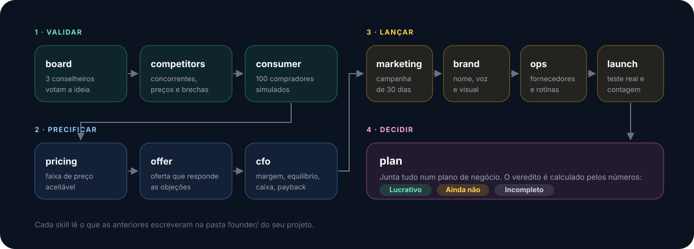

# Founder Skills

<p align="center">
  
</p>

<p align="center">
  
  
  
  
  
</p>

Onze skills do Claude que testam um negócio antes de você lançar. Grátis, sem
cadastro, sem chave de API, nada para conectar.

Uma é o seu conselho de diretores. Outra é o diretor de marketing. Outra é o CFO,
que acha a sua margem de lucro real. E outra é o painel de consumidores: cria 100
compradores simulados a partir do seu cliente ideal e passa o negócio por 100
cenários de compra.

Assim você sabe como lançar, como vender e se dá dinheiro **antes** de gastar
milhares para descobrir do jeito difícil.

## Sumário

- [Instalar](#instalar)
- [As onze skills](#as-onze-skills)
- [Como usar](#como-usar)
- [Exemplo completo](#exemplo-completo)
- [Ferramentas em Python](#ferramentas-em-python)
- [Avisos importantes](#avisos-importantes)
- [Arquivos](#arquivos)

## Instalar

**Opção 1. Plugin do Claude Code (recomendado)**

```
/plugin marketplace add Mrz1nn/founder-skills
/plugin install founder-skills@founder-skills
```

Instaladas como plugin, as skills aparecem com prefixo:
`/founder-skills:founder-board`, `/founder-skills:founder-cfo` e assim por diante.

**Opção 2. Copiar as pastas (comando curto, sem prefixo)**

```bash
git clone https://github.com/Mrz1nn/founder-skills.git
cp -r founder-skills/skills/founder-* ~/.claude/skills/
```

Assim os comandos ficam `/founder-board`, `/founder-cfo` etc. Para valer só em um
projeto, copie as mesmas pastas para `.claude/skills/` dentro dele.

**Opção 3. Colar no Claude**

Cole o link deste repositório numa conversa com o Claude e diga `install skill`:

```
https://github.com/Mrz1nn/founder-skills

install skill
```

**Sem Claude Code?** Cole qualquer `SKILL.md` no começo de uma conversa e ela roda
como modo. Você perde os sub-agentes e as ferramentas em Python, mas o método
funciona.

> As ferramentas precisam de Python 3.8 ou mais novo. Nada para instalar com pip.

## As onze skills

| Comando | Papel | O que faz |
| --- | --- | --- |
| `/founder-board` | Conselho | Três conselheiros, cada um um sub-agente com um framework publicado (Ofertas, de *$100M Offers*; Monopólio, de *De Zero a Um*; Produto, da biografia de *Steve Jobs* por Isaacson), dão nota à ideia, dizem o que mataria o negócio e votam. |
| `/founder-competitors` | Concorrência | Mapeia concorrentes diretos, indiretos e substitutos em fontes públicas: preço, posicionamento e do que os clientes deles reclamam. Todo fato com link. |
| `/founder-consumer` | Painel de consumidores | Cria um enxame de compradores (100 por padrão, 20 com `--quick`), cada um com renda, hábitos e objeção diferentes, e conta quem compra, quem não compra e por quê. |
| `/founder-pricing` | Preço | Transforma as respostas de preço do painel numa faixa aceitável, compara com concorrentes e com a sua margem e escolhe o que testar. |
| `/founder-offer` | Oferta | Monta a oferta (bônus, garantia, urgência real, nome) que responde às objeções e testa de novo no painel. |
| `/founder-cfo` | CFO | Economia unitária: contribuição por venda, margem real, ponto de equilíbrio por dia, ano 1 mês a mês, caixa necessário, payback e cenários. |
| `/founder-marketing` | Marketing | Posicionamento, canais que o seu comprador usa, campanha de lançamento de 30 dias com datas, dez ganchos e quanto você pode pagar por cliente. |
| `/founder-brand` | Marca | Opções de nome com as checagens de marca, domínio e @ a fazer, voz, promessa e briefing visual. |
| `/founder-ops` | Operação | Fornecedores, equipe, rotinas do dia 1, ferramentas, licenças a checar e mapa de riscos. Devolve os custos reais ao CFO. |
| `/founder-launch` | Lançamento | Primeiro um teste barato no mundo real, depois a contagem regressiva, o roteiro do dia e os primeiros 30 dias. |
| `/founder-plan` | Plano de negócio | Junta tudo num plano com veredito calculado pelos números: Lucrativo, Ainda não ou Incompleto. |

Pastas: `skills/founder-board` `skills/founder-competitors` `skills/founder-consumer`
`skills/founder-pricing` `skills/founder-offer` `skills/founder-cfo`
`skills/founder-marketing` `skills/founder-brand` `skills/founder-ops`
`skills/founder-launch` `skills/founder-plan`

## Como usar

<p align="center">
  
</p>

Rode nesta ordem. Cada skill lê o que as outras escreveram na pasta `founder/` do
seu projeto:

```
board -> competitors -> consumer -> pricing -> offer -> cfo -> marketing -> brand -> ops -> launch -> plan
```

Também dá para rodar qualquer uma sozinha. Para uma ideia que você ainda está só
pensando, `/founder-consumer --quick` é um jeito rápido de saber se vale seguir.

**Primeira vez? Comece assim:**

1. Abra o Claude Code na pasta do projeto.
2. Digite `/founder-board` e descreva a ideia em poucas linhas: o que vende, para
   quem, por quanto e onde.
3. Siga a ordem acima. Cada skill diz qual é a próxima.
4. No fim, abra `founder/business-plan.md`.

## Exemplo completo

Um café de matcha em Toronto, latte gelado a US$ 6,50. Todos os dados estão nos
arquivos de exemplo deste repositório, então dá para rodar as ferramentas nele.

1. **`/founder-board`** escreve `founder/idea.md` com o que você contou e leva ao
   conselho. Cada membro dá nota, lista riscos e vota: investe, investe se, ou
   passa. As condições viram checklist para o resto.
2. **`/founder-competitors`** mapeia os cafés e casas de matcha a pé dali, quanto
   cobram por um latte e do que as avaliações reclamam.
3. **`/founder-consumer`** monta o cliente ideal (profissionais urbanos de 24 a 38
   anos que compram café quase todo dia), distribui 100 perfis por renda, hábito e
   objeção e roda um sub-agente por comprador. Volta quem compra, quem passa, os
   motivos com as palavras deles ("meu café é mais perto", "US$ 6,50 é caro para
   uma bebida") e o que viraria um não em sim.
4. **`/founder-pricing`** lê as quatro respostas de preço de cada comprador, monta
   a faixa aceitável e compara US$ 6,50 com ela e com os concorrentes.
5. **`/founder-offer`** responde às principais objeções com a oferta (preço de
   semana de lançamento, cartão fidelidade) e roda um painel rápido para ver se a
   taxa de compra muda.
6. **`/founder-cfo`** calcula a economia unitária:

   | Métrica | Resultado |
   | --- | --- |
   | Sobra por copo, depois dos custos diretos | US$ 4,76 |
   | Ponto de equilíbrio | 186 copos por dia |
   | Margem no volume planejado (383 copos/dia) | 38% |
   | Resultado operacional do ano 1 | US$ 93.926 |
   | Investimento inicial de US$ 25.280 volta no | mês 8 |
   | Caixa necessário até se pagar | US$ 34.092 |

7. **`/founder-marketing`**, **`/founder-brand`**, **`/founder-ops`** e
   **`/founder-launch`** viram campanha de 30 dias, nome e visual, fornecedores e
   rotinas, e um lançamento com data que começa com um pop-up para testar
   compradores reais.
8. **`/founder-plan`** compila `founder/business-plan.md`. O veredito é calculado,
   não escrito: só dá Lucrativo se cada unidade dá lucro, o ano 1 fecha positivo, o
   ponto de equilíbrio cabe na capacidade e uma parte suficiente do painel compra.

## Ferramentas em Python

São quatro, só biblioteca padrão. Nenhuma acessa a internet.

```bash
python3 skills/founder-cfo/unit_economics.py founder/numbers.json --out founder/cfo.md   # margem, equilíbrio, ano 1
python3 skills/founder-consumer/panel.py init --customer founder/customer.json --pitch founder/pitch.md
python3 skills/founder-pricing/van_westendorp.py founder/panel/answers --price 6.50       # faixa de preço aceitável
python3 skills/founder-plan/compile.py --dir founder                                     # plano e veredito
```

| Arquivo | O que faz |
| --- | --- |
| `unit_economics.py` | Lê um JSON (exemplo: `skills/founder-cfo/example.json`) e devolve contribuição, ponto de equilíbrio, margem no plano, ano 1 mês a mês, caixa, payback e três cenários. Todo número vem de um dado de entrada. Campo faltando é erro, nunca chute. |
| `panel.py` | Distribui perfis de comprador a partir do seu cliente ideal (mesma semente, mesmos perfis), escreve um briefing por comprador, confere as respostas e soma. Nunca responde no lugar de um comprador. |
| `van_westendorp.py` | Lê as quatro respostas de preço de cada comprador (do painel ou de um CSV de pesquisa real) e acha os pontos de barato demais, caro demais, preço ótimo e preço de indiferença. |
| `compile.py` | Monta o plano e calcula o veredito. |

Rodar os testes:

```bash
python3 -m unittest discover -s tests -v
```

## Avisos importantes

**O conselho aplica frameworks publicados. Não são essas pessoas.** As três lentes
são resumos curtos, com palavras próprias, de ideias de *$100M Offers* (Alex
Hormozi), *De Zero a Um* (Peter Thiel com Blake Masters) e da biografia de Steve
Jobs escrita por Walter Isaacson. O conselho nunca fala como eles, não os cita e
não diz que eles apoiam nada. Este projeto não tem ligação com nenhum deles.

**O painel de consumidores é simulado. Não são clientes.** Serve para achar
objeções, segmentos e palavras antes de gastar, rápido e barato. Não é previsão:
modelos de linguagem tendem a concordar, então leia a taxa de compra como teto e
confirme as decisões grandes com pessoas reais. `/founder-launch` começa justamente
por esse teste. Resposta do painel é pesquisa: nunca use como depoimento.

**Os números só valem o que valem os dados.** O CFO marca toda estimativa como
estimativa e pede orçamentos reais. Confira custos com fornecedores e estrutura,
folha e impostos com um contador.

**A pesquisa usa fontes públicas, com link.** Nada de concorrentes, preços,
avaliações ou citações inventados. Nada de raspagem contra os termos de um site.

**Não é consultoria financeira, jurídica nem tributária.** Licenças, marcas e
alegações dependem de onde você está. As skills dizem o que checar e onde; um
profissional confirma.

## Arquivos

```
assets/                      imagens do README
skills/founder-board/        SKILL.md, lenses.md
skills/founder-competitors/  SKILL.md
skills/founder-consumer/     SKILL.md, panel.py, customer.example.json, pitch.example.md
skills/founder-pricing/      SKILL.md, van_westendorp.py
skills/founder-offer/        SKILL.md
skills/founder-cfo/          SKILL.md, unit_economics.py, example.json
skills/founder-marketing/    SKILL.md
skills/founder-brand/        SKILL.md
skills/founder-ops/          SKILL.md
skills/founder-launch/       SKILL.md
skills/founder-plan/         SKILL.md, compile.py
tests/                       testes de todas as ferramentas
```

Os seus arquivos ficam em `founder/` no seu projeto. As skills leem os arquivos
umas das outras.

## Licença

MIT. Veja [LICENSE](LICENSE).
